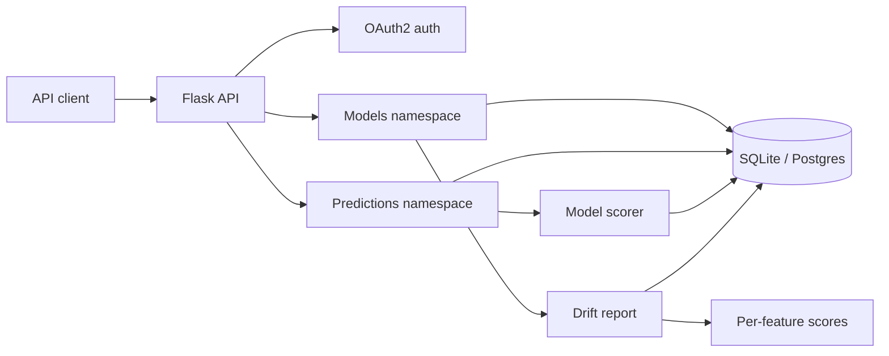
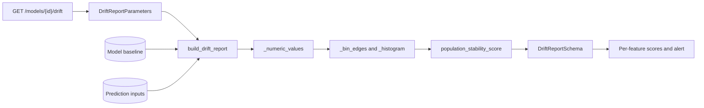

# Driftwatch Model API

A self-documented REST API for serving and monitoring machine learning models.



## Why

A model that scores well in a notebook can quietly degrade once real traffic reaches it, and the serving code around it is a different shape in every project. Driftwatch keeps model registration, prediction logging and drift checks in one small server, so the people who own a model can see when incoming feature values move away from what the model was trained on. It is for engineers and analysts who run a handful of models and want a record of what each one was asked and what it answered.

## How it works

Models are registered with a baseline of feature values captured at registration time. Every prediction request is validated, scored and written to the database together with the feature values it carried. The drift report endpoint reads the recent predictions for a model, compares each feature against the stored baseline and returns a population stability score per feature, with an alert flag when a score crosses the configured threshold.

The drift report is the part added on top of the base server. It lives in `app/modules/models/drift.py` next to the model resources. `DriftReportParameters` in `drift_parameters.py` takes a window size, 500 by default and capped at 10000, and an optional threshold. `build_drift_report` loads the model's `baseline_features` and the `input_features` of the newest `Prediction` rows for that model, then calls `population_stability_score` for each feature in the baseline. That function builds ten bin edges from the baseline with `_bin_edges`, widens the outer edges to catch out-of-range values, turns both samples into proportions with `_histogram` and sums the log ratio of actual to expected share, with a small floor so empty bins do not blow the score up. `_numeric_values` drops booleans, nulls, non-numeric strings and NaN or infinite values before anything is counted. A feature is flagged when its score reaches the threshold, and the report's `alert` is true when any feature is flagged. The threshold comes from the request when given, otherwise from `default_threshold`, which reads `DRIFT_ALERT_THRESHOLD` from the app config at request time. A model registered without a baseline returns a conflict instead of a report.



## Key decisions

- Predictions are stored with their input features rather than only the output, which costs storage per request but makes drift measurable after the fact without a separate logging pipeline.
- The baseline is captured once at registration and kept on the model row, so a report needs no access to the training set and stays reproducible.
- Drift is computed on request from a bounded window instead of a background job, which keeps the deployment to one process at the cost of a slower first call on large windows.
- The API is built on the flask-restplus-server-example layout, keeping its namespaces, Marshmallow schemas and OAuth2 flow instead of a new framework, so the OpenAPI spec and Swagger UI come for free.

## Tech stack

- Python 3 with Flask and flask-restplus
- SQLAlchemy, Flask-SQLAlchemy and Alembic migrations
- Marshmallow and flask-marshmallow for schemas and parameters
- Flask-OAuthlib and Flask-Login for authentication
- Invoke tasks for running the app, the database and the Swagger UI
- Docker and docker-compose for the deployment stacks

## Quick start

Prerequisites: Python 3, pip, and Docker if you use the compose stacks. The app pins Flask 1.1 and SQLAlchemy 1.3 in `app/requirements.txt`.

```bash
pip install -r requirements.txt
invoke app.dependencies.install
invoke app.db.upgrade
invoke app.db.init-development-data
invoke app.run --host 0.0.0.0
```

```bash
docker-compose -f deploy/stack2/docker-compose.yml up --build
```

| Variable | What it sets | Default |
| --- | --- | --- |
| `EXAMPLE_API_REVERSE_PROXY_SETUP` | Whether the app trusts the reverse proxy headers | `False` |
| `EXAMPLE_API_SERVER_SECRET_KEY` | The Flask secret key in production | none |
| `EXAMPLE_API_SERVER_SQLALCHEMY_DATABASE_URI` | The database URI in production | none |
| `FLASK_CONFIG` | Which config class the app loads | `development` |
| `DRIFT_ALERT_THRESHOLD` | The drift score that raises an alert | `0.31` |

## Usage

```bash
curl -s -H "Authorization: Bearer $TOKEN" \
  "http://localhost:5000/api/v1/models/1/drift?window=500&threshold=0.31"
```

```json
{
  "model_id": 1,
  "window": 500,
  "threshold": 0.31,
  "alert": true,
  "features": [
    {"name": "amount", "score": 0.42, "alert": true},
    {"name": "hour_of_day", "score": 0.08, "alert": false}
  ]
}
```

## Project structure

```text
app/
  extensions/     API, auth, database and logging setup
  modules/        auth, users, teams, models and predictions
migrations/       Alembic revisions and development data
tasks/            Invoke tasks for running and migrating
tests/            Pytest suite against the real app
deploy/           docker-compose stacks with a reverse proxy
```

## Limitations

- Drift is measured with a population stability score only; there is no per-feature test selection or automatic retraining.
- The baseline is fixed at registration, so a model that is retrained needs to be registered again to get a new baseline.
- Reports are computed on request and are not cached, so very large windows are slow.
- The bundled deployment uses SQLite by default; Postgres needs the build argument and a database URI.

## License

MIT. This project builds on [flask-restplus-server-example](https://github.com/frol/flask-restplus-server-example), which is also MIT licensed.
